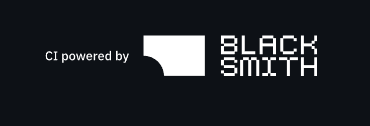
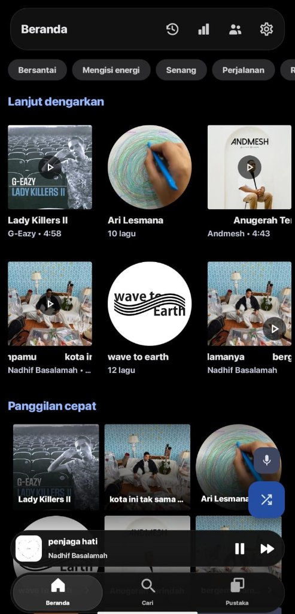
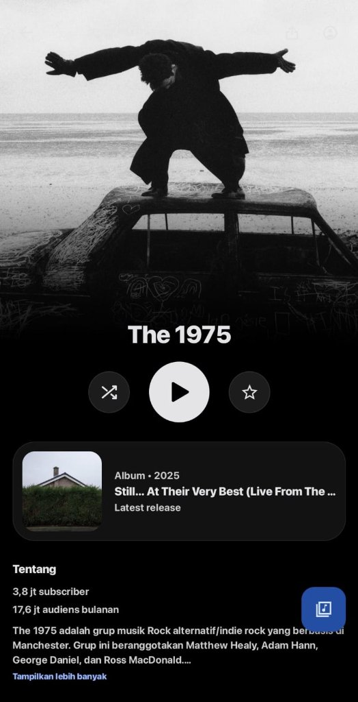
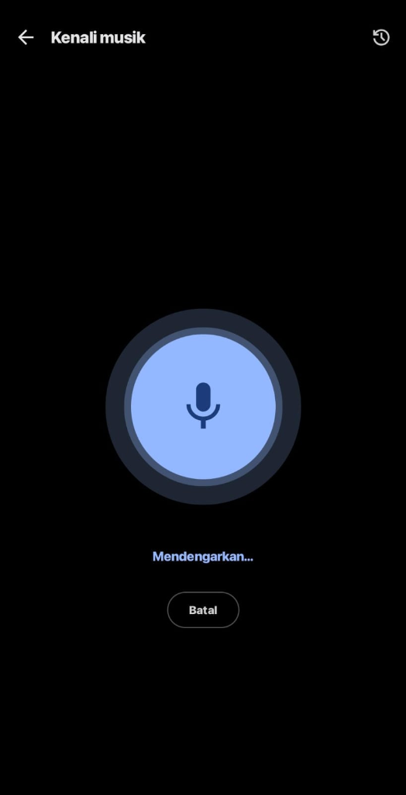
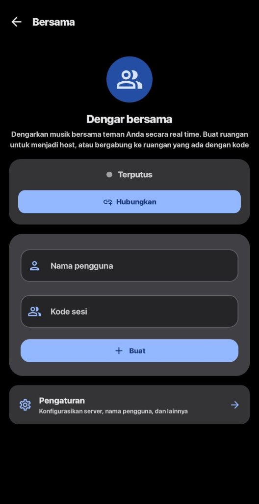
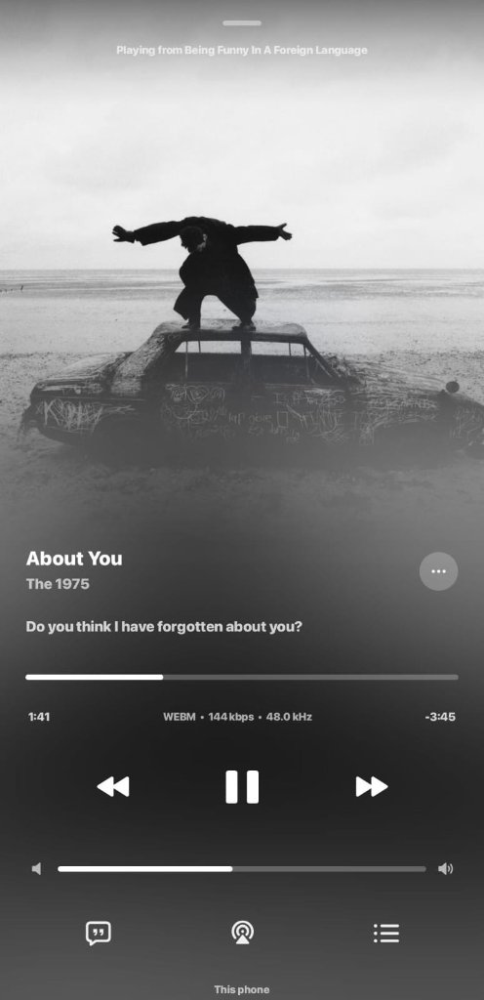
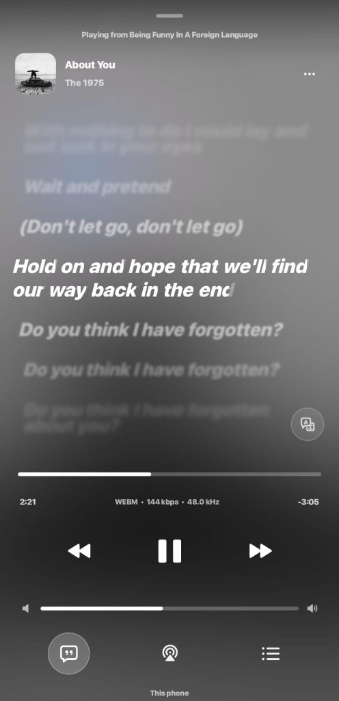

# Songfy

### YouTube Music client for Android

 

 
 

 

 

[**Download**](#download-now) · [**Features**](#features) · [**FAQ**](#faq) · [**Support**](#support-the-project)

> [!WARNING]
> # MAINTENANCE MODE
> Metrolist is currently in maintenance mode. This means we will only be fixing bugs and making minor improvements. Please do not submit PRs for new features or major changes, as they will not be accepted.  
> The app is **NOT** dead, please stay tuned for updates on our discord (found above).

> [!WARNING]
> **Regional Restriction** - If YouTube Music is unavailable in your region, this app will not work without a **VPN or proxy** connecting to a supported region.

---

<h1>Screenshots</h1>

---

<h1>Features</h1>

<table>
  <tr>
    <td width="50%" valign="top">

#### Playback
- Stream songs and videos from YouTube Music
- Background playback
- Download & cache for offline listening
- Skip silence
- Sleep timer & scheduled alarm

</td>
    <td width="50%" valign="top">

#### Audio
- Audio normalization & hardware offload
- Tempo & pitch control
- Built-in equalizer with AutoEQ profiles
- Crossfade playback

</td>
  </tr>
  <tr>
    <td width="50%" valign="top">

#### Lyrics & Discovery
- Multi-provider synced lyrics (BetterLyrics, SimpMusic, Paxsenix, LrcLib, KuGou)
- Interactive lyric seeking with auto-hiding controls
- AI-powered lyrics translation & romanization
- Music recognition powered by ShazamKit
- Quick picks, Speed Dial, & search

</td>
    <td width="50%" valign="top">

#### Library (No Login Required)
- Ready to use immediately without YouTube/Google login
- Full local library management & favorites
- Local playlists with CSV/M3U import & export
- Reorder songs in playlists and queues

</td>
  </tr>
  <tr>
    <td width="50%" valign="top">

#### Social & Sharing
- Listen Together in real-time (no login required)
- Songfy deep-link share URLs with APK download fallback
- Last.fm integration for scrobbling
- Safe Discord Rich Presence

</td>
    <td width="50%" valign="top">

#### Interface
- Mornye-style Now Playing UI with motion artwork & audio output selector
- Liquid Glass floating bottom navigation bar
- Home screen widgets (Player, Turntable, Playlist, Recognizer)
- Light / Dark / Pure Black / Dynamic themes + 19 color palettes (Material 3)

</td>
  </tr>
</table>

---

<h1>Download Now</h1>

---

---

<h1>Support the Project</h1>

<h3>Songfy is free and open-source. If it brings you joy, consider supporting its development!</h3>

  

---

<h1>Contributors</h1>

<h3>Built and maintained by</h3>

 
<b><a href="https://github.com/Rasya457">Rasya457</a></b>

---

<h1>Disclaimer</h1>

This project is **not affiliated with, funded, authorized, endorsed by, or in any way associated** with YouTube, Google LLC, Metrolist Group LLC, or any of their affiliates and subsidiaries.

All trademarks, service marks, and intellectual property rights referenced in this project belong to their respective owners.

---

 

**Made with ❤️ by [Rasya](https://github.com/Rasya457)**

**This project stands with Palestine 🇵🇸**

